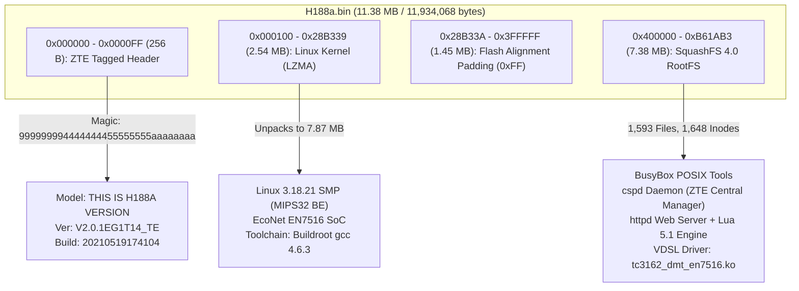

# ZTE ZXHN H188A Management Toolkit & Firmware Analysis Suite

[](https://www.python.org/)
[](#)
[](#)
[](#)
[-6F2C91.svg)](#)

A dedicated, autonomous Python web management dashboard and binary firmware inspection suite engineered specifically for the **ZTE ZXHN H188A** (Hardware Version `V2.0.2`, Firmware `V2.0.1EG1T14_TE` distributed by Telecom Egypt / WE).

---

## Key Features

- **Authentic Dual-Localized Web Interface:**
  - 1-to-1 visual reproduction of the official ZTE carrier interface (Telecom Egypt `#6F2C91` corporate purple and clean gray layout).
  - Instant bilingual toggle between **Arabic** (`dir="rtl"`) and **English** (`dir="ltr"`).
  - Persistent language selection saved across sessions (`localStorage`).
  - Professional, clean design without non-standard emojis or artificial styling.

- **Safe PPPoE WAN IP Renewal:**
  - Restarts the PPPoE session on instance `IGD.WD1.WCD1.WCPPP1` via router CGI endpoints with an automated 6-second cooldown.
  - Acquires a fresh public WAN IPv4 address **without rebooting the router**, preserving Wi-Fi and local network connectivity.
  - Supports non-destructive Dry-Run simulation mode.

- **Real-Time VDSL2 Physical Layer Diagnostics:**
  - Reads physical line metrics directly from the EcoNet EN7516 xDSL DMT subsystem:
    - Downstream / Upstream sync rates (Actual vs. Attainable).
    - SNR noise margin (dB) & line attenuation (dB).
    - CRC cumulative frame errors & Forward Error Correction (FEC) counters.
    - Showtime link duration & modulation standard (`VDSL2 Profile 17a`).

- **Official Router Reboot Controller:**
  - Safely sends hardware reboot dispatch via `deviceManag_lua.lua`.
  - Automated recovery countdown timer (120s) with active health check polling until router responds.

- **Live Syslog Monitoring & Categorized Filtering:**
  - Real-time syslog fetching from the router's internal logging daemon.
  - Fast categorized filters: **All**, **Warnings & Errors**, **PPPoE & DSL**, **Wi-Fi & DHCP**, **Reboots**.
  - Search query box with live row matching and one-click clipboard copying.

- **Firmware Verification & Deep Binary Inspector:**
  - Automated cryptographic & partition parsing of `.bin` firmware files:
    - Validates ZTE Tag magic signature (`999999994444444455555555aaaaaaaa`).
    - Verifies embedded target hardware model (`THIS IS H188A VERSION`).
    - Validates MIPS32 Big-Endian Linux 3.18.21 kernel LZMA decompression.
    - Validates SquashFS 4.0 root filesystem integrity (128KB blocks, LZMA, 1,648 inodes).
    - Calculates MD5 and SHA-256 checksums before staging for upgrade.

---

## Directory Structure

```text
C:\Users\ahmed\Desktop\ZTE\
│
├── Run.bat                      # Single-click launcher (auto port check & browser launch)
├── README.md                    # Project documentation & reverse engineering teardown
├── CHANGELOG.md                 # Version release history and tracking
├── .gitignore                   # Git exclusion rules (credentials, logs, dumps)
│
├── app\                         # Core application package
│   ├── web_app.py               # Standalone multi-threaded HTTP server & web UI
│   ├── config.ini               # Router credentials and configuration
│   ├── config.example.ini       # Template configuration
│   ├── main.py                  # CLI management tool
│   ├── logs\                    # Daily operational logs
│   └── zte_toolkit\             # Modular router interaction library
│       ├── client.py            # HTTP session & token authentication engine
│       ├── connection.py        # Safe PPPoE disconnect/connect manager
│       ├── diagnostics.py       # VDSL & WAN status parser
│       └── logger.py            # Sensitive data redacting logger
│
└── Firmware\                    # Firmware analysis workspace
    ├── H188a.bin                # Official stock firmware binary (11.38 MB)
    ├── rootfs.squashfs          # Carved SquashFS 4.0 root filesystem (7.38 MB)
    └── extracted_sample\        # Extracted Lua and page components for analysis
```

---

## Quick Start

### 1. Prerequisites
- **Operating System:** Windows 10 / 11
- **Python:** Python 3.10 or newer (tested with Python 3.11 x64)
- **Network:** PC connected to ZTE router LAN (via Ethernet cable or Wi-Fi)

### 2. Configuration
Open `app\config.ini` and verify router settings:
```ini
[router]
host = 192.168.1.1
username = admin
password = YOUR_ROUTER_PASSWORD

[connection]
cooldown_seconds = 6
max_retries = 3
verify_timeout = 45
```

### 3. Launching
Double-click:
```bat
Run.bat
```
The script will automatically:
1. Release port `8080` from any stale background processes.
2. Initialize the local web server.
3. Automatically launch your default browser to:
   ```text
   http://127.0.0.1:8080
   ```

---

## In-Depth Firmware Reverse Engineering & Architectural Teardown

A complete static and architectural analysis was performed on the official stock firmware binary (`Firmware\H188a.bin`). Below are the technical findings, partition layout, hardware specifications, and internal daemon structures.

### 1. Firmware Identity & Cryptographic Hashes

| Field | Value |
| :--- | :--- |
| **File Name** | `H188a.bin` |
| **File Size** | `11,934,068 bytes` (11.38 MB / 11,654.36 KB) |
| **MD5 Checksum** | `109e46d8c2ba010f95dc578b197331b9` |
| **SHA-256 Checksum** | `a49bd7639d744668b60772889a65d0e3f5f130d2dbde2cf4a614d074f466b485` |
| **Target Hardware** | **ZTE ZXHN H188A** (Hardware Version: `V2.0.2`) |
| **Software Version** | **`V2.0.1EG1T14_TE`** (Telecom Egypt / WE Official Stock) |
| **Build Timestamp** | `2021-05-19 17:41:04 CST` (UTC: `2021-05-19 09:41:04`) |
| **SoC / Chipset** | **MediaTek / EcoNet EN7516** (Dual-Core MIPS32 Big-Endian) |
| **Kernel Version** | **Linux 3.18.21 SMP** (MIPS 1004Kc / 24KEc, Buildroot gcc 4.6.3) |
| **Root Filesystem** | **SquashFS 4.0** (LZMA Compressed, 128 KB Block Size) |

---

### 2. Binary Memory Map & Partition Analysis



#### Detailed Partition Breakdown:

1. **ZTE Tagged Header (`0x000000 - 0x0000FF`, 256 Bytes):**
   - **Magic Signature:** `99 99 99 99 44 44 44 44 55 55 55 55 AA AA AA AA`
   - **Extracted Header Fields:**
     - Offset `0x004C`: Software version string `V2.0.1EG1T14_TE`
     - Offset `0x00A8`: Hardware compatibility string `THIS IS H188A VERSION`
     - Offset `0x00E4`: Build datestamp `20210519174104` (May 19, 2021, 17:41:04 CST)

2. **Compressed Linux Kernel Partition (`0x000100 - 0x28B339`, 2.54 MB / 2,667,065 Bytes):**
   - **Compression Format:** Standard LZMA (`0x5D 0x00 0x00 0x80 0x00` with 8 MB dictionary).
   - **Decompressed Size:** **`7,870,336 bytes` (~7.51 MB)**.
   - **Kernel Version Banner:**
     ```text
     Linux version 3.18.21 (xialei@localhost.localdomain) (gcc version 4.6.3 (Buildroot 2015.08.1) ) #2 SMP Wed May 19 17:28:50 CST 2021
     ```
   - **Architecture:** MIPS32 Big-Endian SMP (Dual-Core).
   - **Target SoC Platform:** MediaTek / EcoNet **EN7516 / EN7512 / EN7527**.

3. **Flash Alignment Padding (`0x28B33A - 0x3FFFFF`, 1.45 MB / 1,526,983 Bytes):**
   - Filled with `0xFF` bytes to align the Root Filesystem to the exact 4 MB SPI flash block boundary (`0x400000`).

4. **Root Filesystem - SquashFS 4.0 (`0x400000 - 0xB61AB3`, 7.38 MB / 7,739,763 Bytes):**
   - **Superblock Magic:** `hsqs` (SquashFS 4.0 Little-Endian Header).
   - **Compression:** LZMA.
   - **Block Size:** 131,072 bytes (128 KB).
   - **Inodes Count:** 1,648.
   - **File Count:** 1,593 files across 54 directories.
   - **Uncompressed Raw Filesystem Size:** **`29,240,839 bytes` (~27.88 MB)**.

---

### 3. Operating System Architecture & Core Daemons

```text
/ (RootFS)
├── bin/
│   ├── busybox          # Multi-call binary for POSIX utilities (sh, ip, iptables, ifconfig)
│   ├── cspd             # ZTE Central Service Provider Daemon (Core Router Engine) [2.59 MB]
│   ├── httpd            # Embedded HTTP/HTTPS Web Server [1.32 MB]
│   ├── adslcmd / ethcmd # EcoNet physical layer diagnostic and control utilities
│   └── pppd             # Standard Point-to-Point Protocol daemon
├── lib/
│   ├── liblua.so        # Embedded Lua 5.1 runtime engine
│   └── modules/         # Linux Kernel Drivers:
│       ├── tc3162_dmt_en7516.ko  # EcoNet EN7516 VDSL2 DMT physical layer driver [3.3 MB]
│       ├── mt7603eap.ko          # MediaTek MT7603 2.4GHz 802.11n Wi-Fi driver [2.6 MB]
│       └── hw_nat.ko             # Hardware Network Address Translation accelerator
└── home/
    └── httpd/           # Web management application roots & Lua handlers
        ├── index.lua / cgilua.lua
        ├── common_page/          # Functional handlers (PPPoE, DSL, Logs, Upgrade)
        └── config/               # Carrier localization tables (langcn.lua, langen.lua)
```

#### Breakdown of Key System Daemons:

1. **`bin/cspd` (ZTE Central Service Provider Daemon):**
   - The central supervisory daemon (2.59 MB executable).
   - Manages ISP TR-069 Auto-Configuration Server (ACS) communications.
   - Governs PPPoE lifecycle via sub-process `cspd.cspd.ppp_mgr`.
   - Maintains the internal Object Model (`OBJ_` instances like `OBJ_DSLINTERFACE_ID`, `OBJ_UPGRADE_ID`, `OBJ_WANPPP_ID`).

2. **`bin/httpd` (Carrier Web Server):**
   - Listens on TCP port 80 (HTTP) and 443 (HTTPS).
   - Powered by CGILua and embedded Lua 5.1 engine.
   - All `.lua` and `.lp` server pages are pre-compiled into binary bytecode (`\x1bLuaQ`) for rapid execution and intellectual property protection.
   - Original developer build workspace revealed in bytecode symbol tables:
     ```text
     /home/xialei/ws/en7516/chip_en7516/product/H188AV201_TEdata/
     ```

3. **Hardware Modules & Kernel Drivers:**
   - **`tc3162_dmt_en7516.ko`:** Dedicated VDSL2 DMT physical transceiver driver for EcoNet EN7516 supporting VDSL2 Profile 17a and ITU-T G.993.2.
   - **`mt7603eap.ko`:** High-throughput 2.4GHz Wi-Fi driver.
   - **`hw_nat.ko`:** Hardware acceleration module offloading packet routing from the MIPS CPU directly to silicon.

---

### 4. Firmware Upgrade Subsystem & Safety Mechanism

Reverse engineering of `Upgrade_Query_lua.lua` and `ManagDiag_Local_FirmwareUpgr_t.lp` reveals the router's upgrade flow:

1. **Multipart Upload Endpoint:**
   - Form name: `fUpload` submitted as `multipart/form-data`.
   - Target URL: `getpage.lua?pid=100&&`.
   - Binary file input name: `VersionUpload`.
   - Anti-CSRF Token: Protected by a session token `TOKEN_UPLOAD`.

2. **Integrity Validation Checks (Pre-Flash):**
   - The router validates the 16-byte magic pattern: `99 99 99 99 44 44 44 44 55 55 55 55 AA AA AA AA`.
   - Validates that the hardware target string matches `THIS IS H188A VERSION`.
   - Verifies the kernel LZMA block and SquashFS superblock before writing.

3. **State Machine Lifecycle (`OBJ_UPGRADE_ID`):**
   - `state_INIT`: Upgrade session initialized.
   - `state_UPLOADING`: Firmware file stored into RAM (`tmpfs`).
   - `state_WRITING_FLASH`: Erasing and programming SPI flash blocks.
   - `state_REBOOTING`: Automatic hardware reset upon write confirmation.
   - Client queries progress via `/common_page/Upgrade_Query_lua.lua`.

---

### 5. Firmware Customization & Modifiability Considerations

Can this firmware be modified? **Yes, with strict precautions:**

1. **Repacking Requirements:**
   - The RootFS must be repacked with `mksquashfs` using LZMA compression, 128KB block size, and `-b 131072 -comp lzma`.
   - The SquashFS partition must be aligned to the exact `0x400000` (4 MB) boundary using `0xFF` padding.
   - The 256-byte ZTE Tagged Header must be preserved or recalculated with matching version and model tags.
2. **Architecture Constraints:**
   - Any added binaries or compiled tools must target **MIPS32 Big-Endian** with `uClibc` / `glibc` toolchain compatible with GCC 4.6.3 and Linux 3.18.21.
3. **Flashing Safety:**
   - Never interrupt power during flash writes.
   - Always retain the verified `Firmware\H188a.bin` stock binary as a golden recovery image.

---

## REST API Reference

The local server exposes the following JSON endpoints:

| Method | Endpoint | Description |
| :--- | :--- | :--- |
| `GET` | `/` | Web management dashboard HTML |
| `GET` | `/api/status` | Live WAN IP and VDSL physical line telemetry |
| `POST` | `/api/reconnect` | Triggers safe PPPoE session renewal (`dry_run` optional) |
| `GET` | `/api/reconnect/status` | Polls progress and new WAN IP during reconnection |
| `POST` | `/api/reboot` | Dispatches official router reboot command |
| `GET` | `/api/logs` | Fetches router syslog entries with severity levels |
| `POST` | `/api/clear-logs` | Clears local diagnostic log dumps |
| `GET` | `/api/firmware/info` | Returns active firmware specs and local `.bin` file status |
| `POST` | `/api/firmware/inspect` | Performs deep cryptographic inspection of firmware binary |
| `POST` | `/api/firmware/upload` | Handles new `.bin` upload and safety verification |

---

## Security & Safety

- **Password Protection:** Router credentials in `config.ini` are strictly masked and scrubbed from all terminal and file log outputs via `RedactingFormatter`.
- **Non-Destructive Operations:** PPPoE renewal interacts solely with the WAN session and leaves Wi-Fi passwords, LAN DHCP, and VoIP configurations untouched.
- **Flashing Guardrails:** Firmware upgrade tab requires multi-stage verification (Header Magic, Model Matching, Kernel LZMA test, SquashFS integrity) before allowing any flashing action.

---

## License
MIT License. Created for educational, network diagnostic, and personal administration purposes.
